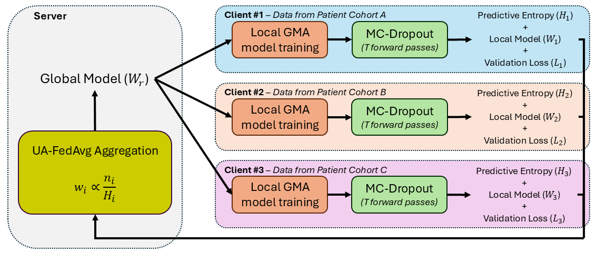

# Uncertainty-Aware Federated Learning for Infant Movement Analysis

Official implementation of:

> **Uncertainty-Aware Federated Learning for Infant Movement Analysis**  
> **Edmond S. L. Ho**

This repository hosts the official implementation of **UA-FedAvg** and the associated experiments presented in the paper *"Uncertainty-Aware Federated Learning for Infant Movement Analysis"*, accepted at the **2026 4th International Conference on Federated Learning Technologies and Applications (FLTA 2026)**.

---

## Overview

Infant movement analysis provides valuable biomarkers for the early identification of neurodevelopmental disorders. Recent advances in deep learning have enabled automated analysis of infant movements from video-derived skeletal representations, achieving performance comparable to expert assessment for tasks such as General Movement Assessment (GMA).

Most existing approaches rely on centralized training, requiring data from multiple institutions to be collected and stored at a single site. Such assumptions are often impractical in clinical settings due to privacy, governance, and data-sharing constraints.

To address these challenges, this work presents, to the best of our knowledge, the first federated learning framework for automated infant movement analysis and General Movement Assessment using skeletal motion data. As a clinically relevant use case, the proposed framework is evaluated on **fidgety movement classification**.

To quantify model confidence, Monte Carlo (MC) Dropout is employed to estimate predictive uncertainty during inference. Building upon this, we propose:

- **UA-FedAvg**: Uncertainty-Aware Federated Averaging based on predictive entropy estimated using MC-Dropout.
- **UA-FedAvg + Validation Loss**: A variant that additionally incorporates validation performance during federated aggregation.

The proposed aggregation strategies adjust client contributions according to predictive uncertainty, enabling more reliable local models to have greater influence on the global model update.



---

## Key Features

- Federated learning for infant movement analysis
- General Movement Assessment (GMA) using skeletal motion data
- Three-client federated learning setup
- Predictive uncertainty estimation using MC-Dropout
- Uncertainty-aware federated aggregation (UA-FedAvg)
- UA-FedAvg with validation loss weighting
- Cross-subject evaluation protocol

---

## Dataset

This work uses the publicly available 2D skeletal motion dataset introduced in:

> Kulvicius, T., Zhang, D., Poustka, L. et al.  
> *Deep learning empowered sensor fusion boosts infant movement classification*.  
> Communications Medicine, 5, 16 (2025).  
> https://doi.org/10.1038/s43856-024-00701-w

### Dataset Access

The dataset is publicly available via Zenodo:

https://doi.org/10.5281/zenodo.14046527

If you use the dataset in your research, please cite the original publication.

---

## Data Partitioning

The experiments reported in the paper were conducted in a **three-client federated learning setting**.

Code for reproducing the client-specific data partitions will be released in a future update.

---

## Installation

Clone the repository:

```bash
git clone https://github.com/<your-username>/UA-FedAvg.git
cd UA-FedAvg
```

Install the required dependencies:

```bash
pip install -r requirements.txt
```

---

## Training

To start training the model, run:

```bash
python main.py
```

Training settings can be modified through main.py.

---

## Methods Implemented

### Centralized Training

Baseline training using pooled data from all participating sites. (coming soon)

### Local Training

Independent client training without federated aggregation. (coming soon)

### FedAvg

Standard Federated Averaging algorithm.

### UA-FedAvg

Federated aggregation weighted according to predictive uncertainty estimated using MC-Dropout.

### UA-FedAvg + Validation Loss

Extension of UA-FedAvg that incorporates both predictive uncertainty and validation performance during aggregation.

---

## Citation

If you use this repository or build upon this work, please cite:

```bibtex
@INPROCEEDINGS{Ho:FLTA2026,
  author={Ho, Edmond S. L.},
  booktitle={2026 4th International Conference on Federated Learning Technologies and Applications (FLTA)},
  title={Uncertainty-Aware Federated Learning for Infant Movement Analysis},
  year={2026},
  volume={},
  number={},
  pages={},
  note={In press}
}
```

---

## Acknowledgements

This work was supported by the **UK Research and Innovation (UKRI) DARE UK Real-world Research Exemplar Programme** (Ref: UKRI4079).

This study utilized the publicly available infant movement dataset released by:

> Kulvicius, T., Zhang, D., Poustka, L. et al.  
> *Deep learning empowered sensor fusion boosts infant movement classification*.  
> Communications Medicine, 5, 16 (2025).  
> https://doi.org/10.1038/s43856-024-00701-w

We thank the authors for making the dataset openly available to the research community.

---

## License

This project is released under the MIT License. See the LICENSE file for details.

---

## Contact

**Edmond S. L. Ho (Shu-Lim.Ho@glasgow.ac.uk)**

For questions, bug reports, or collaboration enquiries, please open an issue on GitHub.
